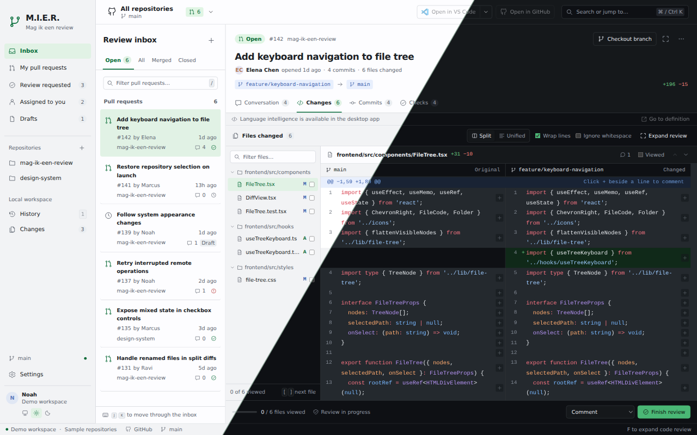

# M.I.E.R.



**Mag ik een review?** A desktop workspace for Git repositories and pull requests, built with Wails 3, Go, React, and TypeScript.

Manage branches and local changes, compare commits, and review pull requests with inline comments, syntax highlighting, and light or dark appearance.

[Stage individual sections, cherry-pick local commits, merge branches, and resolve conflicts](docs/LOCAL_GIT.md) with a side-by-side editor and editable result.

Browse 57 language servers in Settings, with logos, search, install/update controls, and setup instructions. Includes Dockerfiles, YAML, GitHub Actions, and [many more](docs/LANGUAGE_SERVERS.md) for symbol hover and go to definition.

View related [Jira Cloud](docs/JIRA.md) and [Linear](docs/LINEAR.md) tickets alongside a PR using your own OAuth app.

Browse [GitHub Actions](docs/ACTIONS.md), inspect job logs, rerun or cancel runs, and start workflows with their declared inputs.

Connect [GitHub, GitLab, Bitbucket Cloud, and Azure DevOps](docs/REVIEW_PROVIDERS.md) for native reviews and PR stacks.

Review PRs with [ChatGPT/Codex, GitHub Copilot, or your own MCP client](docs/AI.md). AI suggestions become private native review comments for you to inspect before submitting.

[Download the latest release](https://github.com/Noah-Wilderom/mier/releases/latest) · macOS, Windows, and Linux · Intel/AMD and ARM64

[Linux and Omarchy installation](docs/LINUX.md) — DEB, RPM, Arch packages, and AppImage.

## Installation

With `curl` and `jq` installed:

```sh
curl -fsSL https://raw.githubusercontent.com/Noah-Wilderom/mier/master/install.sh | bash
```

The script detects your OS and architecture and installs the latest stable release. Append `-s -- --alpha`, `-s -- --beta`, or `-s -- --rc` to select a prerelease channel. Until the first stable release, use the alpha channel. [Installer options](docs/RELEASING.md#command-line-installation).

## Development

Install Go, Node.js, Git, and the [Wails platform dependencies](https://v3.wails.io/getting-started/installation/), then run:

```sh
go install github.com/wailsapp/wails/v3/cmd/wails3@v3.0.0-alpha2.117
wails3 doctor
wails3 dev
```

[Development guide](docs/DEVELOPMENT.md) · [Releasing and updates](docs/RELEASING.md) · [Architecture](docs/ARCHITECTURE.md)

M.I.E.R. is currently unlicensed.
