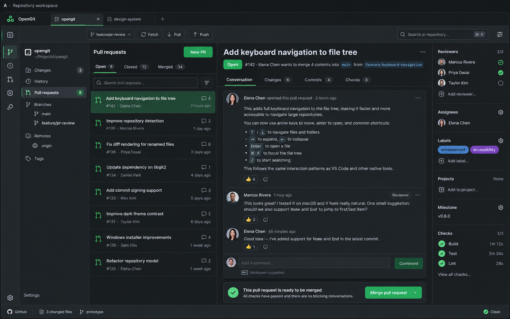

# Research index

Research and implementation experiments collected through 2026-10-13. These notes preserve the primary sources, observed behavior, alternatives considered, and decisions behind the current application. They distinguish documented facts, local experiments, and product choices; they do not claim that every proposed capability has shipped.

| Record | Contents |
| --- | --- |
| [Git, GitHub, and Wails](RESEARCH_GIT_GITHUB_WAILS.md) | Native runtime compatibility, cross-platform boundaries, Git execution/snapshots/authentication, GitHub/enterprise endpoints, pagination, PR schema and protection, notification and editor platform findings |
| [Frontend and design](RESEARCH_FRONTEND.md) | SourceGit/GitKraken references, interface decisions, readability and loading observations, Markdown/emoji rendering, PHP syntax grammar/theme investigation, official assets, and browser regression evidence |
| [Language Server Protocol](RESEARCH_LSP.md) | Protocol/source references, PHP/TS/JS/Vue integration, Vue companion/broker experiments, revision isolation, index/working-tree behavior, dependency links, cancellation, and definition grants |

Operational instructions live in [README.md](../README.md), [architecture](ARCHITECTURE.md), and [language intelligence](LANGUAGE_INTELLIGENCE.md). Product and design decisions are in [PRODUCT.md](../PRODUCT.md) and [DESIGN.md](../DESIGN.md). Final verification is recorded in [VALIDATION.md](VALIDATION.md).

## Initial visual reference

The user supplied the original **Repository workspace A** design again when requesting this handoff. Its unchanged image is retained in the repository:

The image uses the early working name OpenGit. The current brand is **M.I.E.R.**, short for **Mag ik een review**, with slug `mag-ik-een-review`. The later approved Review Inbox direction and system appearance preferences govern the current interface. The image records the starting point; the handoff does not request a fresh redesign or imply that every pictured control is implemented.

## Evidence conventions

- External claims link to official documentation, project source, API schema, or original brand resources.
- Experiment claims identify the tested server/runtime version, fixture, outcome, and repeatable test where available.
- Temporary UI/RPC probes are identified as session evidence. Durable tests are in the repository; redacted browser reports are retained under `docs/validation/`.
- No remote provider writes, real editor launches, real Jira installation, or actual desktop notification delivery were performed by the isolated verification tests.
- Windows/macOS source compilation or available build targets do not establish native runtime, packaging, signing, or keychain validation on those systems.
